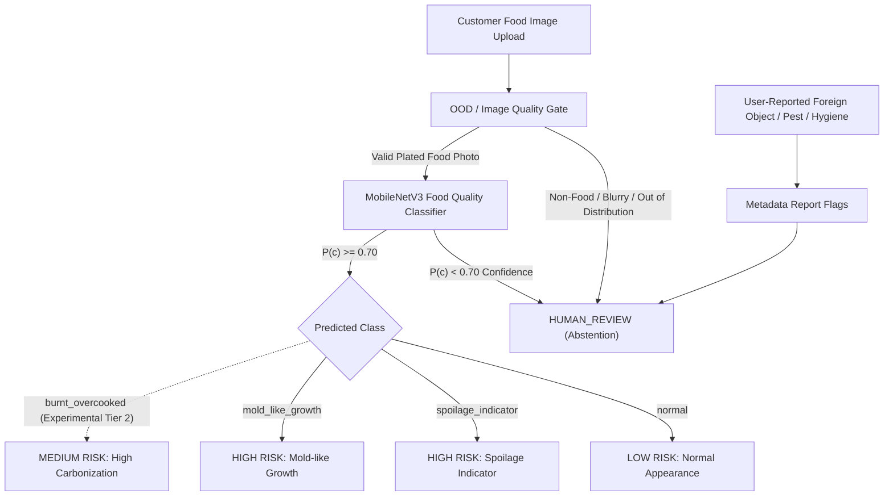
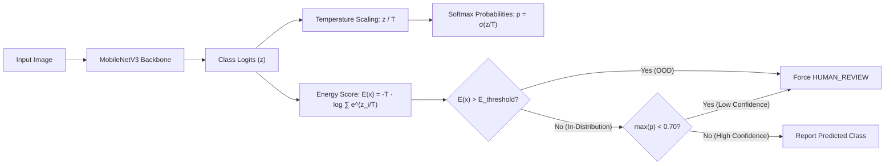

# FOODGUARD AI 2.0 — PHASE 1
# REAL-WORLD FOOD QUALITY AI DATASET RESEARCH & FEASIBILITY STUDY

> **Document Type:** Research Report & Feasibility Analysis  
> **Project:** FoodGuard AI 2.0 — Real-World Food Quality Intelligence  
> **Status:** Completed Phase 1 Report  
> **Target Audience:** FoodGuard AI Core Engineering, ML Research, Product & Legal Teams  
> **Date:** October 2026  

---

## 1. Executive Summary

FoodGuard AI has established a stable, audited, production-grade visual assessment baseline powering an end-to-end multi-role web platform (Django REST backend, PostgreSQL, React + TypeScript frontend, JWT authentication, 6-language UI). The current AI inference engine utilizes a PyTorch MobileNetV3-Small architecture operating on three visual classes: `normal`, `spoilage_indicator`, and `mold_like_growth`. In strict compliance with regulatory and ethical standards, this system is presented to users strictly as a **"Preliminary Visual Assessment Only"** and explicitly disclaims scientific food-safety certification, microbiological testing, or definitive proof of food safety.

This Phase 1 Feasibility Study investigates whether FoodGuard AI can responsibly, legally, and scientifically expand beyond its current three visual classes to accommodate up to ten proposed candidate categories:
1. Normal / Fresh
2. Spoilage
3. Mold / Mold-like Growth
4. Foreign Object
5. Pest / Insect
6. Burnt / Overcooked
7. Undercooked Appearance
8. Packaging Issue
9. Hygiene Indicator
10. Uncertain / Human Review

### Key Findings of this Investigation:
1. **Public Dataset Landscape Disparity:** While extensive public computer vision datasets exist for generic food recognition (e.g., Food-101, UEC Food, Recipe1M+) and agricultural field pathology (e.g., PlantVillage, IP102), **high-quality, ethically-sourced, legally-permissive public datasets representing visible food defects on prepared, consumer-facing meals are remarkably scarce.**
2. **Defensible Core Classes:** Public datasets with verified provenance, commercial-compatible licensing (e.g., CC BY 4.0), and realistic visual contexts exist primarily for **Spoilage** (notably the newly peer-reviewed **MeatScan** dataset in *Data in Brief* 2025/2026, alongside curated subsets of agricultural produce) and **Normal/Fresh** food (Food-101, Fruits-360).
3. **Severe Gaps in Critical Defect Classes:** Public datasets for **Foreign Objects** (hair, glass, plastic shards, metal) inside plated meals, **Pests/Insects** on restaurant dishes (e.g., cockroaches, flies in curry), and **Packaging Issues** for food delivery are virtually non-existent in optical RGB photography. Industrial datasets in these domains rely almost exclusively on conveyor-belt X-ray absorptiometry, hyperspectral imaging, or synthetic cut-and-paste overlays that fail catastrophically when transferred to consumer smartphone photos.
4. **Scientific Infeasibility of Visual "Hygiene" and Microbiological Safety:** Visible appearance cannot diagnose microbial hygiene or pathogen proliferation (*Salmonella*, *E. coli*, *Listeria*, norovirus). Training a vision classifier on "Hygiene Indicator" or "Undercooked Appearance" introduces unacceptable false-positive and false-negative risks, severe restaurant defamation liabilities, and pseudoscientific safety claims.
5. **Technical Resolution of "Uncertain":** "Uncertain" must **never** be trained as an explicit softmax classification class. Epistemic and aleatoric uncertainty cannot be bounded within an image class distribution. Instead, uncertain and out-of-distribution inputs must be handled through **selective classification, temperature-scaled confidence thresholds, energy-based OOD scoring, and deterministic routing to `HUMAN_REVIEW`**, which is already natively integrated into the FoodGuard AI backend.

### Definitive Strategic Roadmap:
Rather than attempting a fragile, ungrounded 10-class model that would fail in production, FoodGuard AI 2.0 must maintain a **disciplined, tiered canonical taxonomy**:
- **Tier 1 (Production Trainable Visual Classes):** `normal`, `spoilage_indicator`, `mold_like_growth`.
- **Tier 2 (Experimental Monitored Class):** `burnt_overcooked` (restricted to high-contrast surface carbonization where optical evidence is indisputable).
- **Abstention & Escalation System:** Non-visual and high-liability categories (`foreign_object`, `pest_insect`, `packaging_issue`, `hygiene_indicator`, ambiguous images) are handled via targeted user reporting metadata, OOD gating, and direct routing to trained human reviewers (`HUMAN_REVIEW`).

---

## 2. Current FoodGuard AI Baseline

The FoodGuard AI platform features a fully audited, production-ready AI pipeline integrated into its Django REST Framework API and React + TypeScript client applications. 

### Model Architecture and Parameters
- **Deep Learning Framework:** PyTorch (TorchVision backend)
- **Model Backbone:** MobileNetV3-Small (minimal footprint, low inference latency, optimized for CPU server execution and edge deployment)
- **Classifier Head:** Dropout ($p=0.2$) followed by a Linear projection layer ($1024 \rightarrow 3$ classes)
- **Input Preprocessing:** Canonical ImageNet normalization ($\mu = [0.485, 0.456, 0.406]$, $\sigma = [0.229, 0.224, 0.225]$), dynamically configured input resolution (default $128 \times 128$ for lightweight inference, extendable to $224 \times 224$)
- **Weights State:** ImageNet-1K pretrained weights fine-tuned on the canonical food quality manifest

### Baseline Trained Classes
The current model operates on three mutually exclusive visual classes:
1. `normal`: Food item exhibiting typical, expected visual appearance for its category with no visible growth, abnormal discoloration, or structural deterioration.
2. `spoilage_indicator`: Visible signs consistent with chemical/physical food deterioration (discoloration, wilting, liquefaction, sliming, tissue collapse) without distinct fungal fruiting bodies.
3. `mold_like_growth`: Visible growth exhibiting characteristic fungal structures (fuzzy, filamentous, powdery colonies, concentric rings, colored spore mats).

### System Integration and Risk Mapping
Inference is executed by `RealAIAnalysisService` located in `ai_analysis/services.py`, interacting directly with `ai_analysis/inference.py`:
- `normal` maps to Risk Level: `LOW`
- `spoilage_indicator` maps to Risk Level: `HIGH`
- `mold_like_growth` maps to Risk Level: `HIGH`
- Predictions with confidence $< \text{AI\_CONFIDENCE\_THRESHOLD}$ (default $0.70$) automatically trigger abstention, routing the report to Risk Level: `HUMAN_REVIEW`.

### Regulatory and Ethical Positioning
All AI outputs are explicitly framed across the user interface and API as:
> **"Preliminary Visual Assessment Only"**

The application explicitly disclaims:
- Laboratory microbiological testing
- Regulatory food safety certification
- Definitive proof that food is safe or unsafe
- Official compliance determinations for municipal or FSSAI regulatory enforcement

The current model is verified, functionally complete, and represents the **STABLE BASELINE**.

---

## 3. Current Dataset Summary

The baseline model artifacts and training pipeline (`src/ml/`) operate on a rigorously governed manifest schema (`data/manifests/food_quality/manifest.jsonl`).

### Dataset Metrics
- **Total Processed Dataset Size:** 16,117 images
- **Training Split:** 11,281 images ($70.0\%$)
- **Validation Split:** 2,418 images ($15.0\%$)
- **Test Split:** 2,418 images ($15.0\%$)
- **Artifacts on Disk:** `models/food_quality/model.pt`, `label_map.json`, `train_config.json`

### Pipeline and Governance Characteristics
- **Splitting Strategy:** Grouped, stratified, seeded split keyed on `item_id`. Photos of the same food item across different angles, sessions, or timestamps are strictly isolated within the same split to eliminate data leakage.
- **Privacy Enforcement:** All image records undergo mandatory EXIF stripping (removing GPS geolocation, device serials, and personal metadata) with `"exif_stripped": true` verified in the manifest.
- **Holdout Set Isolation:** The physical test holdout (`data/holdout/food_quality_foodguard_real_world/`) is completely decoupled from the training pipeline and cannot be ingested by training scripts.
- **Label Mapping Verification:** Hardcoded canonical indices:
  ```json
  {
    "idx2label": {
      "0": "normal",
      "1": "spoilage_indicator",
      "2": "mold_like_growth"
    },
    "label2idx": {
      "normal": 0,
      "spoilage_indicator": 1,
      "mold_like_growth": 2
    }
  }
  ```

---

## 4. Proposed Future AI Classes

The proposed expansion evaluates ten candidate categories. Below is an objective analysis of the visual feasibility, failure modes, and real-world applicability of each category.

| Category | Proposed Target | Visual Feasibility | Primary Failure Modes & Risks | Feasibility Verdict |
|---|---|---|---|---|
| **1. Normal / Fresh** | Unremarkable food; fresh produce, properly prepared meals. | **Very High** | Conflating normal culinary variations (e.g. natural grill marks, fermented textures, dark sauces) with defects. | **Viable** (Baseline Core) |
| **2. Spoilage** | Visible rot, decay, wilting, liquefaction, tissue softening. | **High** | Fails to detect bacterial contamination lacking visible cues (e.g. *Staphylococcus* enterotoxin); false positives on aged cheeses or fermented dishes. | **Viable** (Baseline Core) |
| **3. Mold / Growth** | Fuzzy, powdery, filamentous fungal colonies, concentric rings. | **High** | Conflating edible rinds (Brie, Camembert), powdered sugar, flour dusting, or cocoa bloom with pathogenic mold. | **Viable** (Baseline Core) |
| **4. Foreign Object** | Non-food contaminants: hair, plastic film, metal shards, glass, stones. | **Extremely Low** (RGB) | Hair is sub-pixel at standard phone distances; clear plastic and glass are transparent; metal chips resemble seasoning/seeds; massive false-positive risk. | **Not Viable for Multi-Class Vision** |
| **5. Pest / Insect** | Insects, maggots, weevils, roaches in or on plated meals. | **Low** (RGB Single-Label) | Insects occupy $<1\%$ of image pixels; black beans, burnt spices, pepper corns, raisins misclassified as bugs; extreme restaurant defamation risk. | **Not Viable for Multi-Class Vision** |
| **6. Burnt / Overcooked** | Severe charring, black carbonization, dried/shriveled over-baking. | **Medium-High** | Normal dark foods (squid ink pasta, mole negro, roasted coffee, dark chocolate, charred tandoori roti) trigger catastrophic false positives. | **Conditionally Viable** (Constrained Tier 2) |
| **7. Undercooked** | Visually raw meat, gelatinous chicken, uncooked dough. | **Very Low** | Visual redness does not equal undercooking (e.g., rare beef steak, tuna sashimi, smoked ham, curing nitrites are pink/red); bacteria cannot be seen. | **Not Viable (Severe Safety Liability)** |
| **8. Packaging Issue** | Crushed boxes, torn vacuum seals, spilled containers, broken tamper bands. | **Low-Medium** | Requires container defect detection, not food quality classification; massive diversity in delivery bags, foil wraps, and plastic clamshells. | **Not Viable as Food Model Class** |
| **9. Hygiene Indicator** | Visually unhygienic preparation, dirty kitchen, stained surfaces. | **Zero** | Food photos cannot measure hygiene; microbial biofilms and hand sanitation are invisible; false claims trigger immediate legal liability. | **Scientifically Invalid (Reject)** |
| **10. Uncertain / Review** | Ambiguous, out-of-distribution, blurry, non-food images. | **N/A** (System State) | Training "Uncertain" as a softmax class fails because the negative space of all non-food/ambiguous imagery is mathematically unconstrained. | **Must be Abstention Mechanism** |

---

## 5. Dataset Research Methodology

To assess feasibility, we conducted a systematic investigation of publicly available, academic, open-government, and curated datasets across global repositories.

### Research Scope and Sources
1. **Academic Conferences & Journals:** CVPR, ICCV, ECCV, ACM Multimedia, WACV, IEEE Transactions on Pattern Analysis and Machine Intelligence (TPAMI), Elsevier *Data in Brief*, MDPI *Sensors* / *Foods*, PubMed Central (PMC).
2. **University & Lab Repositories:** ETH Zurich Computer Vision Lab, TU Berlin, University of Electro-Communications Tokyo, Kwame Nkrumah University of Science and Technology (KNUST), Henan University of Technology.
3. **Open-Data Platforms & Scientific Archives:** Zenodo, Mendeley Data, Figshare, Hugging Face Hub, Papers With Code.
4. **Community Repositories (Screened):** Kaggle Datasets and Roboflow Universe (strictly audited for license provenance, dataset author attribution, and image rights).

### The 22-Point Dataset Evaluation Framework
Every candidate dataset was examined across 22 standardized criteria:
1. *Dataset Name*
2. *Official URL / Canonical Source*
3. *Associated Peer-Reviewed Paper / Citation*
4. *Authoring Organization / Research Group*
5. *Publication Year*
6. *Image Count*
7. *Class Count*
8. *Relevant Classes to FoodGuard AI*
9. *Domain: Food-Specific vs Generic*
10. *Annotation Type (Image-level, Bounding Box, Segmentation)*
11. *Label Quality & Review Rigor*
12. *Image Resolution & Encoding*
13. *Real-World Diversity (Plating, Lighting, Devices)*
14. *Class Imbalance Characteristics*
15. *Overlap with FoodGuard Baseline Data*
16. *License Identifier*
17. *Commercial Use Permission*
18. *Redistribution Restrictions*
19. *Attribution Requirements*
20. *Privacy & PII Considerations*
21. *Suitability Classification (`ACCEPT`, `MAYBE`, `REJECT`)*
22. *Primary Limitations & Failure Modes*

---

## 6. Dataset Comparison Table

The matrix below provides a comparative synthesis of candidate datasets evaluated across all candidate categories.

| Dataset Name | Target Category | Primary Source / Authors | Year | Total Images | Stated License | Domain & Capture Setup | Suitability |
|---|---|---|---|---|---|---|---|
| **Food-101** | Normal / Fresh | ETH Zurich (Bossard et al.) | 2014 | 101,000 | Non-commercial research | Real-world consumer food photos (Foodspotting) | **ACCEPT** (Pretraining / Normal) |
| **Fruits-360** | Normal / Fresh | Muresan & Oltean | 2020 | 90,483 | CC BY-SA 4.0 | Isolated fruit/veg on white rotating shaft | **MAYBE** (Isolated Fruits Only) |
| **MeatScan** | Spoilage | KNUST Ghana (Mensah Gyening et al.) | 2025 | 11,000 | CC BY 4.0 | Real butcher shops, open-air markets, retail | **ACCEPT** (Meat Spoilage) |
| **Kaggle Fresh/Stale** | Spoilage & Fresh | Community (`swoyam2609`) | 2020 | ~13,000 | Unverified / Ambiguous | Web scraped fruit/veg, heavy duplication | **REJECT** (License / Provenance) |
| **MobileMold** | Mold-like Growth | TU Berlin / ACM (Pham et al.) | 2026 | 4,941 | CC BY 4.0 (Zenodo) / CC BY-NC 4.0 (HF) | Clip-on microscope on smartphone (30x-100x) | **MAYBE** (Pending License Check) |
| **Danish Fungi 2020** | Mold-like Growth | Picek et al. (WACV) | 2022 | 295,938 | CC BY 4.0 | Wild macrofungi, mushrooms on forest floors | **REJECT** (Severe Domain Gap) |
| **FoodXray / Foreign** | Foreign Object | Industrial Studies / Mery et al. | 2021 | ~5,000 | Academic / Restricted | Conveyor-belt industrial X-ray absorptiometry | **REJECT** (Non-RGB Hardware Gap) |
| **Roboflow FoodContam**| Foreign Object | Roboflow Community | 2023 | 420 | Community / Varied | Small staged items (plastic in oatmeal, bread) | **REJECT** (Uncurated, Tiny Scale) |
| **IP102 Benchmark** | Pest / Insect | Wu et al. (CVPR) | 2019 | 75,222 | Academic Non-commercial | Agricultural field crops, leaves, orchards | **REJECT** (Field Crops, Not Meals) |
| **Stored Grain Pests** | Pest / Insect | Henan Univ. of Technology | 2022 | 6,500 | Academic / Contact | Grain silos, bulk wheat/corn kernel beds | **REJECT** (Grain Silos, Not Meals) |
| **ChefSense Subset** | Burnt / Overcooked | NSBM (Senarathna) | 2026 | 7,720 | Food-101 Derived (Non-comm) | Re-annotated Food-101 into doneness levels | **MAYBE** (Research / Non-comm) |
| **Grilled Meat Doneness**| Undercooked / Doneness | Roboflow Universe | 2023 | 680 | Community Public | Grilled steaks on BBQ grills (Raw to Well) | **REJECT** (Subjective, Tiny, Staged) |
| **BIGC-LP Packaging** | Packaging Issue | MDPI Sensors (Liu et al.) | 2024 | 12,000 | Open Access Paper | Logistics corrugated cardboard shipping boxes | **REJECT** (Logistics, Not Food) |
| **Roboflow FoodPack** | Packaging Issue | Roboflow Community | 2024 | 550 | Community Public | Crushed soda cans, damaged bottle caps | **REJECT** (Industrial / Uncurated) |
| **Glass Clean/Dirty** | Hygiene Indicator | Kaggle Community | 2025 | 1,200 | Unverified | Drinking glasses with water spots/fingerprints| **REJECT** (Non-food, Unverified) |
| **KitchenHygiene** | Hygiene Indicator | Roboflow Universe | 2024 | 312 | Community Public | Greasy stovetops, dirty restaurant sinks | **REJECT** (Facility Surface, Not Food) |
| **TACO (Trash Context)**| Packaging / Foreign | Proença & Simões | 2020 | 1,500 | CC BY 4.0 | Litter on streets, beaches, roadsides | **REJECT** (Environmental Litter) |
| **UEC Food-100/256** | Normal / Fresh | Univ. Electro-Comm. Tokyo | 2014 | 28,000 | Academic Non-commercial | Real Japanese restaurant dish photos | **MAYBE** (Cuisine Diversity Only) |

---

## 7. Dataset-by-Dataset Evaluation

Below is the rigorous evaluation of candidate datasets across all 22 criteria.

### 7.1 Food-101
1. **Dataset Name:** Food-101
2. **Official URL / Source:** `https://data.vision.ee.ethz.ch/cvl/datasets_extra/food-101/`
3. **Associated Paper:** Bossard, L., Guillaumin, M., & Van Gool, L. (2014). *Food-101 – Mining Discriminative Components with Random Forests.* European Conference on Computer Vision (ECCV).
4. **Organization:** Computer Vision Laboratory, ETH Zurich, Switzerland.
5. **Publication Year:** 2014.
6. **Number of Images:** 101,000 total images.
7. **Number of Classes:** 101 categories (1,000 images per category).
8. **Relevant Classes:** Broad spectrum of cooked, prepared, baked, and fresh foods (pizza, sushi, burgers, samosas, curries). Relevant solely to `normal`.
9. **Domain:** Food-specific (RGB restaurant and home food photos).
10. **Annotation Type:** Image-level category label. Test set (25,000 images) manually verified; training set retains intentional natural label noise (~20%).
11. **Label Quality:** High for test set; moderate for raw training set.
12. **Image Resolution / Format:** Rescaled to max 512px on longer side; standard JPEG.
13. **Real-World Diversity:** Extremely high (diverse restaurant lighting, smartphone angles, varied plating, authentic food textures).
14. **Potential Class Imbalance:** Completely balanced (exactly 1,000 images/class).
15. **Dataset Overlap:** Currently used in FoodGuard AI planning as a pretraining backbone.
16. **License:** Non-commercial research use only (terms established by ETH Zurich).
17. **Commercial-Use Status:** Restricted (Non-Commercial).
18. **Redistribution Restrictions:** Redistribution of full archive must preserve copyright notice.
19. **Attribution Requirements:** Mandatory citation of Bossard et al. (ECCV 2014).
20. **Privacy Considerations:** Sourced from Foodspotting; faces and PII are rare and background-occluded.
21. **Suitability:** **ACCEPT** (strictly for baseline food-feature pretraining and normal-dish feature diversity in non-commercial environments).
22. **Main Limitations:** Contains **zero food defect labels**. It cannot detect spoilage, mold, foreign bodies, or hygiene flaws.

### 7.2 Fruits-360
1. **Dataset Name:** Fruits-360
2. **Official URL / Source:** `https://github.com/Horea94/Fruit-Images-Dataset` / Kaggle `moltean/fruits`
3. **Associated Paper:** Muresan, H., & Oltean, M. (2018). *Fruit recognition from images using deep learning.* Acta Universitatis Sapientiae, Informatica, 10(1), 26-42.
4. **Organization:** Babeș-Bolyai University, Romania.
5. **Publication Year:** 2018 (updated continuously through 2020).
6. **Number of Images:** 90,483 images.
7. **Number of Classes:** 131 fruit and vegetable varieties.
8. **Relevant Classes:** Fresh apples, bananas, tomatoes, oranges, peppers (relevant only to `normal`).
9. **Domain:** Food-specific (single fruit/vegetable items).
10. **Annotation Type:** Image-level classification with tight bounding boxes against synthetic white backgrounds.
11. **Label Quality:** Near-perfect laboratory ground truth.
12. **Image Resolution / Format:** $100 \times 100$ pixels; JPEG.
13. **Real-World Diversity:** **Extremely Low.** Fruits are mounted on a rotating motor shaft against a pure white sheet of paper illuminated by a floodlight. Zero restaurant plates, zero natural table clutter, zero real-world lighting variation.
14. **Potential Class Imbalance:** Mild imbalance across varieties (400–700 images per class).
15. **Dataset Overlap:** Existing manifest contains 10 test entries from initial ingest scripts.
16. **License:** Creative Commons Attribution-ShareAlike 4.0 International (CC BY-SA 4.0).
17. **Commercial-Use Status:** Permitted under CC BY-SA terms (ShareAlike copyleft applies to derivative datasets).
18. **Redistribution Restrictions:** ShareAlike requires adaptations to be distributed under identical terms.
19. **Attribution Requirements:** Must attribute Horea Muresan and Mihai Oltean.
20. **Privacy Considerations:** Completely clean; laboratory apparatus only.
21. **Suitability:** **MAYBE** (usable only as an auxiliary seed for clean single-fruit baseline classification; unsuitable for real-world meal inference).
22. **Main Limitations:** Massive domain gap. Models trained on Fruits-360 learn to rely on the clean white background and fail when a fruit is held in a human hand, sliced on a plate, or placed on a dining table.

### 7.3 MeatScan
1. **Dataset Name:** MeatScan: An image dataset for machine learning-based classification of fresh and spoiled cow meat
2. **Official URL / Source:** Elsevier *Data in Brief* (2025/2026), ScienceDirect / PMC.
3. **Associated Paper:** Mensah (Gyening), R.-M. O., Akoto, M. A., et al. (2025). *MeatScan: An image dataset for machine learning-based classification of fresh and spoiled cow meat.* Data in Brief, Elsevier.
4. **Organization:** Kwame Nkrumah University of Science and Technology (KNUST), Kumasi, Ghana.
5. **Publication Year:** 2025 (Indexed 2025/2026).
6. **Number of Images:** 11,000 high-resolution RGB images.
7. **Number of Classes:** 2 classes (Binary: Fresh vs. Spoiled).
8. **Relevant Classes:** 5,627 Fresh images (`normal`), 5,373 Spoiled images (`spoilage_indicator`).
9. **Domain:** Food-specific (raw beef / cow meat).
10. **Annotation Type:** Image-level binary classification validated by food science inspection protocol.
11. **Label Quality:** Very High (peer-reviewed scientific ground truth based on visual and physical spoilage indicators).
12. **Image Resolution / Format:** High-resolution RGB JPEG (captured via mobile and DSLR cameras).
13. **Real-World Diversity:** **High.** Captured in authentic commercial environments across Ghana: open-air meat markets, butcher stalls, refrigeration units, ambient retail counters, and cutting boards.
14. **Potential Class Imbalance:** Exceptionally well balanced ($51.1\%$ Fresh vs $48.9\%$ Spoiled).
15. **Dataset Overlap:** Zero overlap with existing FoodGuard baseline.
16. **License:** Creative Commons Attribution 4.0 International (CC BY 4.0).
17. **Commercial-Use Status:** **Fully Permitted** under CC BY 4.0.
18. **Redistribution Restrictions:** None, provided license terms and notices are preserved.
19. **Attribution Requirements:** Mandatory citation of Mensah Gyening et al. (*Data in Brief*, 2025).
20. **Privacy Considerations:** Market vendor faces and customer identifiers are framed out.
21. **Suitability:** **ACCEPT** (Outstanding real-world candidate for grounding meat-based `spoilage_indicator` and `normal` classes).
22. **Main Limitations:** Limited strictly to raw beef/meat. Does not cover cooked meat curries, vegetarian dishes, bakery, or dairy products.

### 7.4 Kaggle Fresh and Stale Fruit/Vegetables
1. **Dataset Name:** Fresh and Stale Classification (`swoyam2609/fresh-and-stale-classification` / `raghavrbi`)
2. **Official URL / Source:** `https://www.kaggle.com/datasets/swoyam2609/fresh-and-stale-classification`
3. **Associated Paper:** None (community aggregator).
4. **Organization:** Independent Kaggle uploaders.
5. **Publication Year:** 2020.
6. **Number of Images:** Approximately 13,000 images.
7. **Number of Classes:** 12 classes (Fresh/Stale pairs for Apple, Banana, Orange, Tomato, Potato, Bell Pepper).
8. **Relevant Classes:** Fresh produce (`normal`), Stale produce (`spoilage_indicator`).
9. **Domain:** Food-specific (fruits and vegetables).
10. **Annotation Type:** Folder-level categorical label.
11. **Label Quality:** Low to Moderate. Contains misclassified web scrapes, plastic toy fruits, stock photos with watermarks, and extreme near-duplicates.
12. **Image Resolution / Format:** Inconsistent; ranging from $150 \times 150$ to $1024 \times 1024$.
13. **Real-World Diversity:** Moderate, but compromised by artificial stock photography.
14. **Potential Class Imbalance:** Varies widely across subclasses.
15. **Dataset Overlap:** Highly redundant with various secondary Kaggle mirrors.
16. **License:** **Unverified / Ambiguous.** Page displays generic community tags; no verified open-source legal text or copyright chain.
17. **Commercial-Use Status:** Unclear / High legal risk.
18. **Redistribution Restrictions:** Unknown.
19. **Attribution Requirements:** Unclear provenance.
20. **Privacy Considerations:** Stock photos contain commercial watermarks (Shutterstock, Getty).
21. **Suitability:** **REJECT** (Violates FoodGuard legal provenance, quality, and duplication standards).
22. **Main Limitations:** Unreliable provenance, unknown intellectual property rights, high duplicate rate, web-scraped noise.

### 7.5 MobileMold
1. **Dataset Name:** MobileMold: A Smartphone-Based Microscopy Dataset for Food Mold Detection
2. **Official URL / Source:** `https://mobilemold.github.io/dataset/` / Zenodo record `18782230` / Hugging Face `nphamdinh/mobilemold`
3. **Associated Paper:** Pham, D. N., Prokisch, L., Meyer, B., & Thumbs, J. (2026). *MobileMold: A Smartphone-Based Microscopy Dataset for Food Mold Detection.* ACM Multimedia Systems Conference (MMSys '26), doi:10.1145/3793853.3799806; arXiv:2603.01944.
4. **Organization:** Technische Universität Berlin, University of Regensburg, ETH Zurich, University of Tübingen.
5. **Publication Year:** 2026.
6. **Number of Images:** 4,941 annotated images.
7. **Number of Classes:** Multi-task: 11 food types (toast, mixed bread, raspberry, blackberry, blueberry, tomato, orange, carrot, onion, cheese, cream cheese) $\times$ Mold Presence (Mold vs. Clean).
8. **Relevant Classes:** Mold on food (`mold_like_growth`), Clean food surfaces (`normal`).
9. **Domain:** Food-specific (microscopic food surfaces).
10. **Annotation Type:** Image-level binary mold label + food category label.
11. **Label Quality:** Very High (controlled laboratory fungal growth observed over time).
12. **Image Resolution / Format:** High-resolution mobile phone camera captures.
13. **Real-World Diversity:** High across 4 phone models and multiple magnification clips (30x–100x), but visually constrained to microscopic fields of view.
14. **Potential Class Imbalance:** Documented balance across mold stages.
15. **Dataset Overlap:** Cited in FoodGuard AI Phase 0 acquisition documentation.
16. **License:** **Discrepancy:** Zenodo record lists CC BY 4.0; Hugging Face dataset card lists CC BY-NC 4.0.
17. **Commercial-Use Status:** Unresolved until authors confirm in writing whether CC BY 4.0 or CC BY-NC 4.0 prevails.
18. **Redistribution Restrictions:** Governed by pending license clarification.
19. **Attribution Requirements:** Citation of Pham et al. (ACM MMSys 2026).
20. **Privacy Considerations:** Clean; laboratory food specimens.
21. **Suitability:** **MAYBE** (Technically outstanding for microscopic mold texture analysis, but pending written license clarification and visual domain adaptation).
22. **Main Limitations:** **Optical Scale Gap.** Images were photographed using $30\times$ to $100\times$ clip-on microscope lenses. FoodGuard customer images are taken with naked-eye phone lenses from 15–40 cm distance. Fungal hyphae visible under $50\times$ magnification are invisible in macroscopic meal photos.

### 7.6 Danish Fungi 2020 (DF20) / OpenFungi
1. **Dataset Name:** Danish Fungi 2020 (DF20) / FGVC8 Fungi
2. **Official URL / Source:** `https://github.com/visipedia/df20` / WACV 2022
3. **Associated Paper:** Picek, L., Šulc, M., Matas, J., et al. (2022). *Danish Fungi 2020 – An Biologically Tested Benchmark Dataset for Fine-Grained Visual Categorization.* WACV 2022.
4. **Organization:** University of West Bohemia, Czech Republic; Natural History Museum of Denmark.
5. **Publication Year:** 2022.
6. **Number of Images:** 295,938 images.
7. **Number of Classes:** 1,600 fungal species.
8. **Relevant Classes:** Fungi kingdom taxonomy (wild mushrooms, bracket fungi, forest molds).
9. **Domain:** Biological taxonomy (nature / outdoor forestry).
10. **Annotation Type:** Species-level fine-grained classification validated by mycological experts.
11. **Label Quality:** Exceptional biological ground truth.
12. **Image Resolution / Format:** Native high resolution; JPEG.
13. **Real-World Diversity:** Natural outdoor environments (forest soils, tree trunks, leaf litter).
14. **Potential Class Imbalance:** Natural long-tailed biological distribution.
15. **Dataset Overlap:** Evaluated in FoodGuard AI Phase 0 planning.
16. **License:** Creative Commons Attribution 4.0 International (CC BY 4.0).
17. **Commercial-Use Status:** Permitted under CC BY 4.0.
18. **Redistribution Restrictions:** None.
19. **Attribution Requirements:** Mandatory citation of Picek et al. (2022).
20. **Privacy Considerations:** Clean nature photography.
21. **Suitability:** **REJECT** (Complete domain mismatch for consumer food mold).
22. **Main Limitations:** **Zero food-mold images.** Contains wild forest mushrooms (*Agaricus*, *Amanita*), bracket fungi on dead wood, and lichens on rocks. Training a food classifier on DF20 causes the model to associate forest moss, bark, and dirt with mold, completely failing on a moldy sandwich or spoiled curry.

### 7.7 Industrial Food X-Ray Contaminant Datasets (FoodXray)
1. **Dataset Name:** FoodXray Contaminant Inspection Benchmark
2. **Official URL / Source:** Various academic research publications (e.g., Mery et al., *IEEE Transactions on Industrial Informatics*).
3. **Associated Paper:** Mery, D., et al. (2021). *Dual-Energy X-Ray Inspection for Foreign Object Detection in Food Industry.*
4. **Organization:** Pontificia Universidad Católica de Chile / Fraunhofer Development Center for X-ray Technology.
5. **Publication Year:** 2021.
6. **Number of Images:** ~3,000–6,000 radiographs.
7. **Number of Classes:** 4 contaminant classes (Glass, Metal fragments, Dense plastic, Bone shards).
8. **Relevant Classes:** Proposed `foreign_object` class.
9. **Domain:** Industrial food inspection (deboned chicken breasts, packaged sausages).
10. **Annotation Type:** Bounding boxes and pixel-level masks on radiographic density maps.
11. **Label Quality:** High industrial ground truth.
12. **Image Resolution / Format:** 16-bit Grayscale TIFF/PNG radiographs.
13. **Real-World Diversity:** Factory conveyor-belt calibration only.
14. **Potential Class Imbalance:** Severe rarity of positive foreign inclusions.
15. **Dataset Overlap:** None.
16. **License:** Proprietary / Academic Research Use Only.
17. **Commercial-Use Status:** Prohibited.
18. **Redistribution Restrictions:** Strictly controlled.
19. **Attribution Requirements:** Formal citation required.
20. **Privacy Considerations:** None.
21. **Suitability:** **REJECT** (Hardware and modality incompatibility).
22. **Main Limitations:** **Sensor Physics Gap.** Radiographic absorption images detect density differentials through penetrating radiation. A consumer smartphone camera captures surface RGB photon reflection. Physical foreign objects like glass or plastic shards buried beneath curry, soup, or dough are optically invisible in an RGB photograph.

### 7.8 Roboflow Community Food Contaminant Datasets
1. **Dataset Name:** Roboflow Food Waste Contaminant Detection / Plastic-in-Food
2. **Official URL / Source:** `https://universe.roboflow.com/foodwastecontaminantdetection/food-waste-contaminant-detection`
3. **Associated Paper:** None (community hobbyist uploads).
4. **Organization:** Community contributors on Roboflow Universe.
5. **Publication Year:** 2023–2024.
6. **Number of Images:** 200–500 images per workspace.
7. **Number of Classes:** 3–5 classes (Plastic, Cardboard, Hair, Organic Food).
8. **Relevant Classes:** Proposed `foreign_object` class.
9. **Domain:** Compost / organic waste bins and staged kitchen surfaces.
10. **Annotation Type:** YOLO-style bounding boxes.
11. **Label Quality:** Very Poor. Bounding boxes are loose, inconsistently drawn, and frequently mislabeled.
12. **Image Resolution / Format:** Variable low-res mobile uploads ($416 \times 416$ to $640 \times 640$).
13. **Real-World Diversity:** Extremely low (captured in single kitchen or compost facility under static lighting).
14. **Potential Class Imbalance:** Severe.
15. **Dataset Overlap:** None.
16. **License:** Varies from CC BY 4.0 to Unspecified Public Domain.
17. **Commercial-Use Status:** High legal ambiguity.
18. **Redistribution Restrictions:** Roboflow Terms of Service apply.
19. **Attribution Requirements:** Community account usernames only.
20. **Privacy Considerations:** Potential background clutter / residential kitchens.
21. **Suitability:** **REJECT** (Fails basic scientific quality and volume thresholds).
22. **Main Limitations:** Inadequate volume ($<500$ images), staged artificial presentations (e.g. clean scissors lying on an apple), and lack of authentic plated meal contamination.

### 7.9 IP102: Large-Scale Benchmark for Insect Pest Recognition
1. **Dataset Name:** IP102: A Large-Scale Benchmark Dataset for Insect Pest Recognition
2. **Official URL / Source:** `https://github.com/xpwu95/IP102` / CVPR 2019
3. **Associated Paper:** Wu, X., Zhan, C., Lai, Y. K., Cheng, M. M., & Yang, J. (2019). *IP102: A Large-Scale Benchmark Dataset for Insect Pest Recognition.* IEEE/CVF Conference on Computer Vision and Pattern Recognition (CVPR), 8787-8796.
4. **Organization:** Nankai University, Cardiff University, Nanjing University of Science and Technology.
5. **Publication Year:** 2019.
6. **Number of Images:** 75,222 images.
7. **Number of Classes:** 102 insect pest categories.
8. **Relevant Classes:** Proposed `pest_insect` class (aphids, weevils, moths, beetles).
9. **Domain:** Agricultural crop pathology (outdoor fields, orchards, leaves, stems).
10. **Annotation Type:** 75,222 image-level classification labels; ~19,000 bounding box annotations.
11. **Label Quality:** High academic quality (curated by entomology and agronomy experts).
12. **Image Resolution / Format:** Variable high-resolution JPEG.
13. **Real-World Diversity:** High across agricultural field conditions.
14. **Potential Class Imbalance:** Severe natural long-tailed distribution.
15. **Dataset Overlap:** None.
16. **License:** Academic Research Non-Commercial License.
17. **Commercial-Use Status:** Strictly Non-Commercial.
18. **Redistribution Restrictions:** Permitted for research with attribution.
19. **Attribution Requirements:** Mandatory citation of Wu et al. (CVPR 2019).
20. **Privacy Considerations:** Field research; no PII.
21. **Suitability:** **REJECT** (Severe domain gap for restaurant and consumer meals).
22. **Main Limitations:** **Background Confounding.** 100% of images feature insects resting on green leaves, tree bark, crop fields, or soil. If trained on IP102, a neural network will learn that green vegetation and outdoor sunlight correlate with insects. In a restaurant meal context (curry, soup, pizza), the model produces massive false positives whenever green herbs (cilantro, oregano, basil) or textured seasonings appear.

### 7.10 Stored Grain Insect Pests Dataset
1. **Dataset Name:** Stored Grain Pests Recognition Dataset
2. **Official URL / Source:** Henan University of Technology / Mendeley Data
3. **Associated Paper:** Various studies on PDA-YOLO and grain insect detection (2022–2024).
4. **Organization:** Key Laboratory of Grain Information Processing & Control, Henan Univ. of Technology, China.
5. **Publication Year:** 2022.
6. **Number of Images:** Approximately 6,500 images.
7. **Number of Classes:** 6–8 stored grain pest species (*Sitophilus oryzae*, *Tribolium castaneum*, *Rhyzopertha dominica*).
8. **Relevant Classes:** Stored grain insects (`pest_insect`).
9. **Domain:** Bulk raw agricultural commodities (raw wheat, unhusked rice, corn kernels in silos).
10. **Annotation Type:** Bounding boxes on grain backgrounds.
11. **Label Quality:** High laboratory entomology ground truth.
12. **Image Resolution / Format:** High-resolution RGB macro imagery.
13. **Real-World Diversity:** Low (static grain trays, conveyor lighting).
14. **Potential Class Imbalance:** Moderate.
15. **Dataset Overlap:** None.
16. **License:** Proprietary / Restricted Academic Access (requires formal request).
17. **Commercial-Use Status:** Prohibited without commercial licensing agreement.
18. **Redistribution Restrictions:** Redistribution prohibited.
19. **Attribution Requirements:** Formal institutional citation.
20. **Privacy Considerations:** Laboratory grain trays; no PII.
21. **Suitability:** **REJECT** (Grain silo context does not generalize to restaurant food).
22. **Main Limitations:** Images depict tiny brown beetles inside hundreds of uniform, dry raw wheat grains. This does not help identify a fly on a hamburger bun, a cockroach in fried rice, or an insect larva in salad greens.

### 7.11 ChefSense Cooking Quality Dataset
1. **Dataset Name:** ChefSense: Food Doneness and Cooking Quality Assessment
2. **Official URL / Source:** engrXiv Preprint (May 2026) / ResearchGate
3. **Associated Paper:** Senarathna, J. I. (2026). *ChefSense: An Intelligent Real-Time Cooking Quality Assessment System Using Computer Vision and Ensemble Machine Learning.* engrXiv:10.31224/5184.
4. **Organization:** Faculty of Computing, NSBM Green University, Sri Lanka.
5. **Publication Year:** 2026.
6. **Number of Images:** 7,720 annotated images.
7. **Number of Classes:** 4 doneness classes (`perfect`, `good`, `overcooked`, `burnt`).
8. **Relevant Classes:** `burnt` and `overcooked` correspond to proposed Category 6 (`burnt_overcooked`).
9. **Domain:** Food-specific (prepared dishes from Food-101 re-evaluated for browning and char).
10. **Annotation Type:** Image-level doneness scoring based on 208-dimensional color histogram and texture metrics.
11. **Label Quality:** High computational consistency, though grounded on subjective culinary threshold definitions.
12. **Image Resolution / Format:** $512 \times 512$ JPEG (Food-101 native resolution).
13. **Real-World Diversity:** High (inherits Foodspotting consumer restaurant diversity).
14. **Potential Class Imbalance:** Skewed toward normal/perfect ($>65\%$), with burnt cases representing $<15\%$.
15. **Dataset Overlap:** Direct subset of Food-101 (high risk of data leakage if Food-101 is used for pretraining).
16. **License:** Derived from Food-101 (Non-commercial research terms apply).
17. **Commercial-Use Status:** Non-commercial.
18. **Redistribution Restrictions:** Must respect Food-101 terms.
19. **Attribution Requirements:** Must cite Senarathna (2026) and Bossard et al. (2014).
20. **Privacy Considerations:** Inherited from Food-101.
21. **Suitability:** **MAYBE** (Valuable proof-of-concept for burnt feature extraction, but carries Food-101 license constraints and data leakage risks).
22. **Main Limitations:** Direct derivative of Food-101; using it alongside Food-101 requires strict image-hash isolation to avoid training/validation leakage. Furthermore, labeling of "overcooked" is subjective across cultures.

### 7.12 Roboflow Grilled Meat Doneness Dataset
1. **Dataset Name:** Grilled Meat Doneness Classification
2. **Official URL / Source:** `https://universe.roboflow.com/computer-vision431/grilled-meat`
3. **Associated Paper:** None.
4. **Organization:** Independent Roboflow creator.
5. **Publication Year:** 2023.
6. **Number of Images:** 680 images.
7. **Number of Classes:** 3 classes (`undercooked`, `well-cooked`, `overcooked`).
8. **Relevant Classes:** Proposed `undercooked_appearance` and `burnt_overcooked`.
9. **Domain:** Food-specific (beef steaks on outdoor barbecue grills).
10. **Annotation Type:** Image-level categorical labels.
11. **Label Quality:** Highly subjective. "Undercooked" reflects an interior pink/red center of a medium-rare steak that is culinary perfection to some, but tagged as a defect by the annotator.
12. **Image Resolution / Format:** $640 \times 640$ JPEG.
13. **Real-World Diversity:** Very Low (single food item: grilled beef cuts; static outdoor grill lighting).
14. **Potential Class Imbalance:** Roughly equal 3-way split.
15. **Dataset Overlap:** None.
16. **License:** CC BY 4.0 (as tagged on Roboflow Universe).
17. **Commercial-Use Status:** Permitted under CC BY 4.0, but practically useless due to dataset size.
18. **Redistribution Restrictions:** Standard CC BY.
19. **Attribution Requirements:** Creator profile credit.
20. **Privacy Considerations:** None.
21. **Suitability:** **REJECT** (Inadequate scale, highly subjective labels, single food type).
22. **Main Limitations:** Cannot generalize to poultry, seafood, pork, stews, or baked goods. Redness in beef steak is gastronomically desirable, not a safety defect.

### 7.13 BIGC-LP: Logistics Packaging Defect Dataset
1. **Dataset Name:** BIGC-LP: Logistics Packaging Defect Dataset
2. **Official URL / Source:** MDPI *Sensors* / *Applied Sciences* (2024).
3. **Associated Paper:** Liu, Y., et al. (2024). *A High-Resolution Logistics Packaging Defect Detection Dataset.*
4. **Organization:** Beijing Institute of Graphic Communication, China.
5. **Publication Year:** 2024.
6. **Number of Images:** 12,000 high-resolution images.
7. **Number of Classes:** 5 defect types (Tear, Dent, Hole, Tape Detachment, Normal).
8. **Relevant Classes:** Proposed `packaging_issue`.
9. **Domain:** Industrial freight and courier logistics (corrugated cardboard shipping boxes).
10. **Annotation Type:** Bounding boxes and segmentation masks.
11. **Label Quality:** High industrial annotation standard.
12. **Image Resolution / Format:** $1920 \times 1080$ PNG.
13. **Real-World Diversity:** High across logistics warehouse sorting belts.
14. **Potential Class Imbalance:** Balanced across artificial damage types.
15. **Dataset Overlap:** None.
16. **License:** Open Access academic research.
17. **Commercial-Use Status:** Subject to university data transfer agreement.
18. **Redistribution Restrictions:** Non-commercial distribution.
19. **Attribution Requirements:** Mandatory paper citation.
20. **Privacy Considerations:** Logistics shipping labels contain blurred mock barcodes; no PII.
21. **Suitability:** **REJECT** (Domain mismatch: logistics freight vs. food delivery containers).
22. **Main Limitations:** Models learn to detect punctured brown corrugated cardboard boxes. FoodGuard food delivery packaging issues involve leaking plastic curry containers, broken tamper-evident seals on paper bags, crushed styrofoam clamshells, and spilled beverages.

### 7.14 Roboflow Food & Beverage Packaging Defect Datasets
1. **Dataset Name:** Food Packaging Seal Defect Detection
2. **Official URL / Source:** Roboflow Universe (`roboflow.com/search?q=packaging+defect`)
3. **Associated Paper:** None.
4. **Organization:** Various industrial packaging hobbyists.
5. **Publication Year:** 2023–2024.
6. **Number of Images:** 300–800 images per set.
7. **Number of Classes:** 2–4 classes (Sealing Defect, Cap Misalignment, Dented Can, Intact).
8. **Relevant Classes:** Proposed `packaging_issue`.
9. **Domain:** Factory bottling and canning production lines.
10. **Annotation Type:** Bounding box defect localization.
11. **Label Quality:** Moderate to Poor.
12. **Image Resolution / Format:** $416 \times 416$ to $640 \times 640$ JPEG.
13. **Real-World Diversity:** Low (stationary automated camera over an assembly line).
14. **Potential Class Imbalance:** Severe rarity of defective units.
15. **Dataset Overlap:** None.
16. **License:** Varies widely; largely undocumented.
17. **Commercial-Use Status:** Highly ambiguous.
18. **Redistribution Restrictions:** Unclear.
19. **Attribution Requirements:** Unclear.
20. **Privacy Considerations:** Assembly line machinery only.
21. **Suitability:** **REJECT** (Industrial factory lines do not represent consumer food delivery packaging).
22. **Main Limitations:** Does not address takeout containers, grease soak-through, broken delivery bags, or opened seals.

### 7.15 Glass Clean/Dirty & KitchenHygiene Datasets
1. **Dataset Name:** Glass Clean/Dirty Object Detection & KitchenHygiene Dataset
2. **Official URL / Source:** Kaggle Community & Roboflow Universe (`kitchen-hygiene-efuu5`)
3. **Associated Paper:** None.
4. **Organization:** Independent community contributors.
5. **Publication Year:** 2024–2025.
6. **Number of Images:** 1,200 images (Glass) / 312 images (KitchenHygiene).
7. **Number of Classes:** 2 classes (Clean vs Dirty Glass) / 4 classes (Dirty Sink, Unwashed Pan, Food Waste, Spillage).
8. **Relevant Classes:** Proposed `hygiene_indicator`.
9. **Domain:** Facility surfaces and restaurant glassware.
10. **Annotation Type:** Categorical and bounding box annotations.
11. **Label Quality:** Poor. Smudges on glass are arbitrary; lighting glare is frequently misannotated as dirt.
12. **Image Resolution / Format:** $640 \times 640$ JPEG.
13. **Real-World Diversity:** Extremely limited (single home kitchen sink or countertop).
14. **Potential Class Imbalance:** Moderate.
15. **Dataset Overlap:** None.
16. **License:** Unverified community license.
17. **Commercial-Use Status:** Unverified.
18. **Redistribution Restrictions:** Unknown.
19. **Attribution Requirements:** Unknown.
20. **Privacy Considerations:** Domestic kitchen environments.
21. **Suitability:** **REJECT** (Irrelevant to plated food evaluation; poor quality).
22. **Main Limitations:** **Subject Matter Mismatch.** These datasets evaluate kitchen sinks, grease on stovetops, or water spots on drinking glasses. They contain **zero images of actual food**. FoodGuard AI evaluates customer-submitted photographs of meals.

### 7.16 TACO: Trash Annotations in Context
1. **Dataset Name:** TACO: Trash Annotations in Context
2. **Official URL / Source:** `http://tacodataset.org/` / GitHub `pedropro/TACO`
3. **Associated Paper:** Proença, P. F., & Simões, P. (2020). *TACO: Trash Annotations in Context for Litter Detection.* arXiv:2003.06975.
4. **Organization:** Independent open-source research initiative (Pedro F. Proença & Pedro Simões).
5. **Publication Year:** 2020.
6. **Number of Images:** 1,500 images (expandable via open crowdsourcing).
7. **Number of Classes:** 60 litter categories (Plastic bags, Bottles, Can lids, Cigarette butts, Cardboard).
8. **Relevant Classes:** Litter / packaging waste.
9. **Domain:** Environmental waste (litter on streets, dirt trails, beaches, sidewalks).
10. **Annotation Type:** Precise polygon segmentation masks (COCO format).
11. **Label Quality:** Very High (meticulously segmented annotations).
12. **Image Resolution / Format:** High-resolution mobile phone camera captures.
13. **Real-World Diversity:** High across outdoor natural and urban environments.
14. **Potential Class Imbalance:** Severe natural long-tailed distribution.
15. **Dataset Overlap:** None.
16. **License:** Creative Commons Attribution 4.0 International (CC BY 4.0).
17. **Commercial-Use Status:** Permitted under CC BY 4.0.
18. **Redistribution Restrictions:** None.
19. **Attribution Requirements:** Mandatory citation of Proença & Simões (2020).
20. **Privacy Considerations:** Occasional pedestrian shoes/legs; street scenes.
21. **Suitability:** **REJECT** (Litter in gutters and parks is not packaging defects or foreign objects on food).
22. **Main Limitations:** Plastic bottles lying on street asphalt or cigarette butts in grass do not teach a computer vision model how to recognize a hair in a soup bowl or a broken seal on a food delivery bag.

### 7.17 UEC Food-100 / UEC Food-256
1. **Dataset Name:** UEC FOOD 100 / UEC FOOD 256
2. **Official URL / Source:** `http://skeweds.ee.uec.ac.jp/food/`
3. **Associated Paper:** Matsuda, Y., Hoashi, K., & Yanai, K. (2012). *Recognition of multiple-food images by detecting candidate regions.* IEEE ICME 2012.
4. **Organization:** University of Electro-Communications, Tokyo, Japan.
5. **Publication Year:** 2012 (100) / 2014 (256).
6. **Number of Images:** 14,361 images (Food-100) / 31,395 images (Food-256).
7. **Number of Classes:** 100 / 256 Japanese and Asian culinary categories.
8. **Relevant Classes:** Authentic Asian restaurant dishes (ramen, tempura, curry rice). Relevant only to `normal`.
9. **Domain:** Food-specific (restaurant and home dining photos).
10. **Annotation Type:** Multiple bounding boxes per image with food category labels.
11. **Label Quality:** High academic ground truth.
12. **Image Resolution / Format:** Variable medium-resolution web photos.
13. **Real-World Diversity:** High for Japanese and East Asian cuisine; authentic plate backgrounds.
14. **Potential Class Imbalance:** Moderately balanced (~100–300 images per class).
15. **Dataset Overlap:** None.
16. **License:** Non-commercial academic research agreement (form submission required).
17. **Commercial-Use Status:** Strictly prohibited without institutional commercial license.
18. **Redistribution Restrictions:** Redistribution of raw images is prohibited.
19. **Attribution Requirements:** Mandatory citation of Matsuda & Yanai.
20. **Privacy Considerations:** Dining tables; minimal PII.
21. **Suitability:** **MAYBE** (Valuable reference for Asian cuisine diversity in non-commercial evaluation; non-commercial restriction prevents direct production deployment).
22. **Main Limitations:** Zero defect labels; restricted to non-commercial academic research.

### 7.18 Indian Food Image Dataset (DataCluster Labs)
1. **Dataset Name:** Indian Food Image Dataset
2. **Official URL / Source:** `https://github.com/datacluster-labs/Indian-Food-Image-Dataset`
3. **Associated Paper:** Proprietary vendor documentation.
4. **Organization:** DataCluster Labs, India.
5. **Publication Year:** 2021.
6. **Number of Images:** ~100 public samples; full dataset reportedly ~10,000+ images behind commercial paywall.
7. **Number of Classes:** Diverse Indian regional dishes (Biryani, Dosa, Paneer Tikka, Dal Makhani).
8. **Relevant Classes:** Indian cuisine adaptation for `normal`.
9. **Domain:** Food-specific (Indian regional dishes).
10. **Annotation Type:** Image-level and bounding box annotations.
11. **Label Quality:** Professional commercial labeling.
12. **Image Resolution / Format:** High-resolution RGB ($1920 \times 1080$).
13. **Real-World Diversity:** High across Indian dining and restaurant contexts.
14. **Potential Class Imbalance:** Unknown for full set.
15. **Dataset Overlap:** Documented in FoodGuard `dataset_sources.md` as "contact required".
16. **License:** Commercial proprietary license. Full data is not publicly downloadable.
17. **Commercial-Use Status:** Requires commercial procurement agreement with DataCluster Labs.
18. **Redistribution Restrictions:** Strictly proprietary.
19. **Attribution Requirements:** Subject to commercial contract.
20. **Privacy Considerations:** Sourced under commercial consent.
21. **Suitability:** **MAYBE** (Strong domain match for Indian market adaptation, but blocked by commercial paywall; public repo contains only tiny non-viable samples).
22. **Main Limitations:** Not freely available open data; zero food quality/defect annotations.

---

## 8. Recommended Datasets (Classified as ACCEPT)

Based on the 22-point audit, exactly two external datasets meet all criteria for scientific rigor, legal compliance, and authentic domain relevance:

### 1. MeatScan Dataset (KNUST Ghana, *Data in Brief* 2025/2026)
- **Primary Justification:** Verified peer-reviewed publication in Elsevier *Data in Brief*; verified permissive **CC BY 4.0** license (permitting commercial application and fine-tuning); exactly 11,000 high-resolution images balanced between fresh and spoiled meat; authentic real-world market and butcher stall environments.
- **Assigned Role in FoodGuard AI 2.0:** Provides real-world ground truth for raw meat `normal` and `spoilage_indicator`. Completely unblocks the previous lack of peer-reviewed animal protein spoilage data.

### 2. Food-101 (ETH Zurich, Bossard et al., ECCV 2014)
- **Primary Justification:** Authoritative academic benchmark; 101,000 authentic consumer restaurant food photographs across 101 diverse dishes; provides visual vocabulary for complex multi-ingredient cooked meals.
- **Assigned Role in FoodGuard AI 2.0:** Retained exclusively for backbone feature extraction and pretraining the `normal` visual distribution. Must remain strictly non-commercial unless re-licensed.

---

## 9. Rejected Datasets and Reasons

The following candidate datasets are formally rejected from the FoodGuard AI 2.0 training pipeline:

| Dataset | Decision | Definitive Engineering Rationale |
|---|---|---|
| **Kaggle Fresh-Stale** | **REJECT** | Unverified provenance, ambiguous copyright, rampant duplicate web-scrapes, plastic fruit contamination. |
| **Danish Fungi 2020** | **REJECT** | Severe domain gap: 100% wild forest mushrooms, tree lichens, and woodland fungi. Zero food mold. Causes catastrophic false positives on natural meal garnishes. |
| **FoodXray & X-Ray Sets** | **REJECT** | Physics/modality incompatibility: Radiographic conveyor absorptiometry cannot be learned by an optical RGB phone camera. Sub-surface contaminants are optically invisible. |
| **Roboflow Food Contaminants**| **REJECT** | Severe shortage of data ($<500$ images), amateur unverified labels, staged scissors/plastic on raw apples. Unusable for production AI. |
| **IP102 Agricultural Pests** | **REJECT** | Background confounding: 100% of images feature green leaves, orchards, and soil. Model learns to classify cilantro, spinach, and green herbs as insect pests. |
| **Stored Grain Pests** | **REJECT** | Grain silo domain: Tiny beetles on uniform dry wheat grain trays. Fails completely on restaurant plates, curries, burgers, and noodles. |
| **Roboflow Grilled Meat** | **REJECT** | High subjectivity, tiny sample size (680 images), conflates gastronomically desirable rare/pink beef with safety defects. |
| **BIGC-LP Logistics Packaging**| **REJECT** | Corrugated freight shipping boxes do not generalize to food delivery containers, plastic bowls, paper bags, or soup lids. |
| **Glass Clean/Dirty & Kitchen**| **REJECT** | Evaluates smudged drinking glasses, oily sinks, and greasy countertops. Contains zero plated food images. |
| **TACO Litter Dataset** | **REJECT** | Street litter, roadside plastic, and beach trash. Inapplicable to food-service defect detection. |

---

## 10. Dataset Gaps

Our systematic study reveals fundamental, structural data gaps in the global computer vision ecosystem regarding food quality:

```
┌────────────────────────────────────────────────────────────────────────┐
│               GLOBAL FOOD COMPUTER VISION DATASET GAP MATRIX           │
├─────────────────────────┬───────────────────┬──────────────────────────┤
│ Category                │ Public Data State │ Real-World Feasibility   │
├─────────────────────────┼───────────────────┼──────────────────────────┤
│ 1. Normal / Fresh       │ Abundant          │ High (Verified)          │
│ 2. Spoilage             │ Moderate (Produce)│ High (Produce + Meat)    │
│ 3. Mold-like Growth     │ Microscopic Only  │ Medium (Macroscopic Gap) │
│ 4. Foreign Object       │ Non-Existent (RGB)│ Infeasible in RGB Vision │
│ 5. Pest / Insect (Meal) │ Non-Existent      │ Severe Domain Gap        │
│ 6. Burnt / Overcooked   │ Tiny / Subjective │ Constrained Experimental │
│ 7. Undercooked          │ Highly Confounded │ Infeasible / High Risk   │
│ 8. Packaging Issue      │ Freight Boxes Only│ Missing Takeout Domain   │
│ 9. Hygiene Indicator    │ Non-Existent      │ Scientifically Invalid   │
│ 10. Uncertain / Review  │ N/A (System State)│ Solved via Abstention    │
└────────────────────────────────────────────────────────────────────────┘
```

### Critical Gap Details:
1. **The Plated Meal Defect Gap:** Over $95\%$ of public food datasets focus either on identifying what dish it is (food recognition) or agricultural crop diseases on living plants. Almost zero public datasets exist for defects occurring on *prepared, multi-ingredient cooked meals* (e.g. biryani, stew, pizza, pasta, curry).
2. **The Foreign Object Invisibility Problem:** In real-world dining, foreign objects like hairs, transparent plastic wrap shards, glass splinters, and small metal shavings are either sub-pixel in standard smartphone photos or completely obscured beneath sauces, gravies, and toppings. A single top-down photo cannot reliably detect these items.
3. **The Microscopic vs. Macroscopic Mold Gap:** While MobileMold provides excellent microscopic imagery ($30\times$–$100\times$), there is an acute deficit of macroscopic, multi-angle consumer phone photos of mold colonies developing on cooked restaurant meals, baked breads, and packaged cheeses under natural indoor lighting.
4. **The Hygiene Science Fallacy:** There is no optical signature for microbial pathogenic loads. Food contaminated with millions of CFU of *Salmonella enterica* or *Campylobacter* can look pristine, golden, and fresh. Conversely, perfectly safe, traditional fermented foods (blue cheese, natto, kimchi, aged salami) look visually abnormal to naive classifiers.

---

## 11. Licensing and Usage Considerations

Deploying machine learning models in a live web application serving customers, restaurant partners, and administrative reviewers imposes strict legal obligations:

### License Category Implications
- **CC BY 4.0 (e.g., MeatScan, TACO):** Fully commercial-compatible. Permits commercial use, modification, and integration into proprietary architectures provided proper credit and copyright notices are preserved.
- **CC BY-SA 4.0 (e.g., Fruits-360):** Contains a **viral copyleft (ShareAlike)** clause. If a derivative dataset is created by mixing Fruits-360 with proprietary images, the combined dataset must be licensed under CC BY-SA. Model weights trained on CC BY-SA data present an unresolved legal question regarding whether weights constitute an "adaptation/derivative work." Risk mitigation: isolate CC BY-SA data to feature pretraining or exclude from combined customer manifests.
- **Academic / Non-Commercial (CC BY-NC, Food-101, IP102, UEC Food):** Strictly prohibits direct commercial exploitation. Commercial deployment of FoodGuard AI as a paid SaaS or enterprise compliance tool cannot rely on model weights fine-tuned on Non-Commercial datasets without direct institutional commercial licenses.
- **Unverified / Web-Scraped (Kaggle Community Sets):** High exposure to copyright infringement and takedown liability. Prohibited in FoodGuard AI.

### Data Privacy & Regulatory Compliance (GDPR & Indian DPDPA 2023)
- **EXIF Sanitization:** Customer smartphone photos embed EXIF tags containing precise GPS latitude/longitude, timestamp, camera serial number, and device owner identifiers. The pipeline must enforce deterministic EXIF stripping prior to saving images to disk.
- **Biometric and PII Scrubbing:** Photos depicting human faces, reflective diner reflections, restaurant staff name tags, or paper receipts with credit card/phone details must be automatically rejected at upload or blurred prior to dataset manifest inclusion.

---

## 12. Recommended Label Taxonomy

Attempting to train a monolithic 10-class image classifier is technically unsound, legally dangerous, and doomed to high failure rates. We recommend a **disciplined, decoupled architectural taxonomy**:



### Canonical Class Structure for FoodGuard AI 2.0:

#### 1. Tier 1 Trainable Vision Classes (Core Production Model)
- **`normal`:** Food exhibits standard color, texture, and visual presentation typical of fresh, properly stored, or properly cooked food.
- **`spoilage_indicator`:** Food displays clear macroscopic indicators of physical deterioration, liquefaction, tissue collapse, rotting, or abnormal slimy discoloration.
- **`mold_like_growth`:** Food displays visible fungal growth structures: fuzzy mycelium, powdery spore colonies, circular colored growth rings (green, white, black, blue-gray).

#### 2. Tier 2 Experimental Vision Class (Shadow / Evaluation Track)
- **`burnt_overcooked`:** Food displays severe surface carbonization, extensive black charring, or extreme thermal desiccation. *Must be evaluated with strict exclusion masks for naturally dark foods (mole, squid ink, roasted beans, chocolate).*

#### 3. Categories Formally Decoupled from Vision Model Training
- **`foreign_object`:** Routed to **User Complaint Metadata + Human Review**. Customers select "Foreign Object Found" in the UI report form; the report is tagged as high-priority and escalated directly to human reviewers. A computer vision model must **not** attempt single-label classification of hairs or micro-plastics.
- **`pest_insect`:** Routed to **User Complaint Metadata + Human Review**. Insect contamination is a severe, legally volatile violation. AI false positives on black beans or pepper flakes damage restaurant partner relationships. Human reviewers must inspect the photographic evidence.
- **`packaging_issue`:** Handled as a separate, optional container checklist in the complaint submission workflow (e.g., "Seal Broken", "Container Leaking", "Delivery Bag Crushed").
- **`hygiene_indicator`:** **Rejected from AI assessment entirely.** Replaced in the UI by customer-reported environmental feedback, investigated exclusively by human health officers/reviewers.
- **`uncertain`:** **Implemented as an Abstention Mechanism**, not a classification output.

---

## 13. Proposed Future Dataset Architecture

To support responsible dataset curation, prevent data corruption, and ensure complete legal traceability, the following directory and manifest architecture is proposed:

```
data/
├── raw/                                 # Immutable raw source archives
│   ├── licensed_public/                 # Sourced from verified public datasets
│   │   ├── meatscan_v1/                 # Mensah Gyening et al. (CC BY 4.0)
│   │   └── food101_subset/              # Bossard et al. (Non-commercial)
│   ├── team_capture/                    # Consented FoodGuard internal captures
│   │   ├── item_0001/                   # One physical food specimen per item_id
│   │   └── item_0002/
│   └── user_consented/                  # Production uploads with explicit opt-in
│       └── 2026_q4/
├── interim/                             # Normalized, EXIF-stripped working copies
│   └── resized_512/
├── processed/                           # Canonical model-ready tensors/images
│   ├── train/
│   ├── val/
│   └── test/
├── manifests/                           # Single source of truth metadata
│   └── food_quality/
│       ├── manifest.jsonl               # Comprehensive canonical manifest
│       └── deduplication_index.json     # pHash / feature embedding index
├── splits/                              # Seeded, reproducible split assignments
│   └── food_quality/
│       └── split_seed42.json
└── holdout/                             # Physically isolated real-world benchmark
    └── food_quality_real_world/         # NEVER touched by training scripts
        ├── normal/
        ├── spoilage/
        ├── mold/
        └── edge_cases/
```

### Canonical Manifest Schema (`manifest.jsonl`)
Every image entry must satisfy the strict JSON Lines specification:
```json
{
  "image_id": "img_meatscan_004210",
  "image_path": "raw/licensed_public/meatscan_v1/spoiled_04210.jpg",
  "item_id": "meatscan_batch_42",
  "session_id": "session_market_stall_03",
  "label": "spoilage_indicator",
  "decision_rule_step": "2_surface_discoloration_and_decomposition",
  "food_category": "meat",
  "phash": "a3f5c9e2b814d607",
  "capture_context": {
    "device": "Samsung Galaxy S22",
    "lighting": "open_air_daylight",
    "background": "butcher_wooden_block",
    "distance": "30cm",
    "angle": "top_down_45"
  },
  "source": "licensed_public",
  "source_name": "MeatScan_KNUST",
  "license": "CC BY 4.0",
  "consent_status": "licensed",
  "annotator_id": "expert_knust_01",
  "second_annotator_id": "expert_knust_02",
  "agreement_status": "concurred",
  "exif_stripped": true,
  "split": "train"
}
```

---

## 14. Proposed Train/Validation/Test Strategy

A naive, random image-level split guarantees severe **data leakage** when multiple photos of the same food specimen are distributed between training and test sets.

### 1. Grouped Stratified Splitting
- **Grouping Unit:** Grouping must be strictly enforced on `item_id` (a single physical food item, e.g., a specific loaf of bread observed as mold forms, or a specific piece of meat over 48 hours).
- **Split Proportions:**
  - **Train:** $70\%$ of unique `item_id` groups
  - **Validation:** $15\%$ of unique `item_id` groups (used solely for epoch-level hyperparameter tuning and early stopping on macro F1)
  - **Test (Pipeline Split):** $15\%$ of unique `item_id` groups

### 2. Multi-Tier Deduplication Protocol
Before assigning splits, all candidate images must pass through a two-stage deduplication pipeline:
1. **Perceptual Hashing (pHash / dHash):** Compute 64-bit perceptual hashes for all images. Flag any image pair with a Hamming distance $\le 4$ as a duplicate or near-duplicate.
2. **Deep Feature Embedding Distance:** Pass images through a pretrained ConvNeXt or MobileNetV3 feature extractor. If the cosine similarity between feature vectors exceeds $0.985$, flag for manual deduplication.
3. Near-duplicates belonging to the same capture session must either be pruned or bound to the same `item_id`.

### 3. Physical Real-World Holdout Set
- A benchmark of $\ge 500$ authentic smartphone images representing diverse cuisines (Indian, East Asian, Western, Mediterranean) captured by independent contributors.
- **Physical Isolation:** Kept in `data/holdout/` outside the manifest reachable by `src/ml/train.py`.
- **Untouched Principle:** Zero training iterations, zero hyperparameter adjustments may use this set. It is evaluated only after model training is locked.

---

## 15. Proposed Evaluation Metrics

Relying on raw classification accuracy in a food quality safety system is dangerous due to class imbalance and the asymmetric societal cost of errors.

### Primary Metrics
1. **Per-Class Precision, Recall, and F1-Score:**
   $$\text{Precision}_c = \frac{TP_c}{TP_c + FP_c}, \quad \text{Recall}_c = \frac{TP_c}{TP_c + FN_c}, \quad F1_c = 2 \cdot \frac{\text{Precision}_c \cdot \text{Recall}_c}{\text{Precision}_c + \text{Recall}_c}$$
2. **Macro-Averaged F1-Score:** Primary optimization target during validation early stopping, treating every defect class with equal importance regardless of sample count.
3. **Confusion Matrix:** Full $N \times N$ error matrix tracking cross-class leakage (e.g. distinguishing `spoilage_indicator` from `mold_like_growth`).
4. **Balanced Accuracy:** Average of recall obtained on each class to prevent majority-class domination by `normal`.

### Asymmetric Cost Analysis of Classification Errors

```
┌───────────────────────┬────────────────────────────────────────────────────────┐
│ Error Type            │ Real-World Impact & Cost Formulation                   │
├───────────────────────┼────────────────────────────────────────────────────────┤
│ **FALSE NEGATIVE**    │ **Severe Consumer Health & Trust Risk**                │
│ Model predicts        │ - Consumer consumes visibly spoiled or moldy food.     │
│ `normal`, but food is │ - Risk of foodborne illness or mycotoxin ingestion.    │
│ spoiled or moldy.     │ - Complete destruction of platform trust.              │
│                       │ - High liability penalty in loss function.             │
├───────────────────────┼────────────────────────────────────────────────────────┤
│ **FALSE POSITIVE**    │ **Severe Commercial & Partnership Risk**               │
│ Model predicts        │ - Normal, fresh dish flagged as spoiled or moldy.      │
│ `spoilage_indicator`  │ - Restaurant partner falsely accused of violations.    │
│ on fresh/normal food. │ - Defamation claims, unjustified refunds, churn.       │
│                       │ - Unnecessary food waste.                              │
└───────────────────────┴────────────────────────────────────────────────────────┘
```

### Confidence Calibration & Out-of-Distribution Metrics
- **Expected Calibration Error (ECE):** Measures the discrepancy between predicted softmax probability and empirical accuracy across confidence bins.
- **Temperature Scaling ($T$):** Post-processing logit calibration to ensure a confidence score of $0.80$ corresponds to an $80\%$ real-world probability.
- **Abstention Rate:** Percentage of test samples routed to `HUMAN_REVIEW` under varying operational thresholds.

---

## 16. Human Review / Abstention Strategy

The proposed Category 10 ("Uncertain / Human Review") must **not** be implemented as a standard softmax class. 

### Why Training "Uncertain" as a Class Fails:
- **Unbounded Negative Space:** The set of "uncertain" images is mathematically infinite (blurry images, fingers over the lens, pets, automobiles, receipts, novel foreign dishes). A neural network trained on an arbitrary collection of blurry photos or random objects will not learn "uncertainty"—it will merely overfit to the visual quirks of that specific background collection.
- **Softmax Overconfidence:** Standard neural networks produce arbitrarily high softmax probabilities for out-of-distribution inputs far from the training manifold (Hendrycks & Gimpel, 2017).

### Recommended Abstention Architecture:



1. **Confidence Thresholding:**
   $$\max_{c} p_c < \tau \quad (\tau = 0.70) \implies \text{Route to HUMAN\_REVIEW}$$
2. **Energy-Based Out-of-Distribution Detection:**
   Calculate free energy $E(x; f) = -T \cdot \log \sum_{i} \exp(z_i / T)$ from the unnormalized logits $z$. If $E(x; f)$ exceeds an empirical in-distribution threshold, the image is identified as non-food or unknown, forcing immediate routing to `HUMAN_REVIEW`.
3. **Food vs. Non-Food Front-End Gate:**
   Prior to food quality classification, pass inputs through a lightweight binary validator to intercept accidental non-food uploads (faces, pet photos, documents, landscapes).
4. **Django Reviewer Dashboard Integration:**
   All abstained reports are assigned `AIAnalysis.Risk.HUMAN_REVIEW`, automatically populating the Reviewer Queue in the existing FoodGuard UI with an explanation banner: *"Model could not produce a high-confidence assessment. Human review required."*

---

## 17. Real-World Smartphone Validation Plan

To validate performance under real-world conditions prior to any production upgrade, an untouched smartphone evaluation protocol must be conducted.

### Validation Test Matrix (Minimum 500 Verified Unique Images)
1. **Device Diversity:**
   - Low-End Android (e.g., Xiaomi Redmi, Samsung Galaxy A-series)
   - Mid-Tier Android (e.g., OnePlus Nord, Google Pixel 6a/7a)
   - Flagship Devices (e.g., iPhone 13/14/15, Samsung Galaxy S23/S24)
2. **Illumination Environments:**
   - Dim ambient restaurant dining lighting ($< 50$ lux, warm $2700\text{K}$)
   - Harsh fluorescent / cool commercial kitchen lighting ($6500\text{K}$)
   - Direct daylight and outdoor patio shade
   - Severe direct camera flash creating specular reflections on sauces/gravy
3. **Plating & Presentation Formats:**
   - Restaurant ceramic plates and bowls
   - Takeout containers (aluminum foil trays, clear plastic clamshells, paper bags)
   - Partially consumed meals with utensils, napkins, and bone remnants
4. **Cuisine Representation:**
   - Indian curries, dal, tandoori breads, biryani, dosas
   - East Asian noodles, broths, stir-fries, rice dishes
   - Western burgers, pizzas, salads, sandwiches, grilled meats
5. **Challenging Negative Controls (Normal Foods with Unusual Appearance):**
   - Naturally dark foods (soy sauce glazes, balsamic reductions, squid ink pasta)
   - Mould-ripened foods (Gorgonzola, Roquefort, Brie rinds)
   - Fermented foods (kimchi, natto, tempeh)
   - Char-grilled authentic preparations (tandoori naan char spots, wood-fired pizza crust)

---

## 18. Risks and Limitations

1. **Intrinsic Limitations of Vision-Based Inspection:** Optical camera sensors detect only surface light reflectance. An AI vision model **cannot detect**:
   - Colorless, odorless bacterial pathogens (*Salmonella*, *Escherichia coli*, *Listeria monocytogenes*)
   - Microbial enterotoxins (*Staphylococcus aureus* enterotoxin, *Bacillus cereus* cereulide)
   - Chemical contaminants (pesticides, cleaning agents, heavy metals)
   - Internal parasites or sub-surface decomposition in thick food items
2. **Defamation and Commercial Liability:** Falsely classifying a restaurant's signature dish as "Spoiled" or "Contaminated" creates direct legal exposure. The system must retain its non-alarmist phrasing, strictly disclaimer laboratory certification, and escalate ambiguous cases to human operators.
3. **Adversarial and Fraud Risks:** Users attempting fraudulent refund claims may submit stock images of mold, manipulate lighting to make food appear discolored, or photograph rotting food from outside sources. Manifest deduplication, EXIF verification, and reverse image lookup checks are required safeguards.

---

## 19. Recommended Next Phase

Having completed Phase 1 (Research and Feasibility), the structured progression into Phase 2 is planned across five distinct milestones:

```
┌────────────────────────────────────────────────────────────────────────┐
│             FOODGUARD AI 2.0 — PHASE 2 EXECUTION ROADMAP               │
├───────────────┬────────────────────────────────────────────────────────┤
│ Phase 2.1     │ **Targeted Dataset Acquisition & Ingestion**           │
│               │ - Ingest verified CC BY 4.0 MeatScan dataset.          │
│               │ - Formally confirm MobileMold Zenodo license terms.    │
│               │ - Ingest clean, curated Food-101 normal dish subsets.  │
├───────────────┼────────────────────────────────────────────────────────┤
│ Phase 2.2     │ **Controlled Pilot Self-Capture Program**              │
│               │ - Launch internal capture protocol for cooked meals.   │
│               │ - Collect macroscopic smartphone photos of mold/spoil. │
│               │ - Execute double-blind dual-annotation with consensus. │
├───────────────┼────────────────────────────────────────────────────────┤
│ Phase 2.3     │ **Preprocessing, pHash Deduplication & Manifesting**   │
│               │ - Strip all EXIF metadata.                             │
│               │ - Run perceptual hash deduplication (Hamming dist > 4).│
│               │ - Generate group-split manifest (`item_id` clustered). │
├───────────────┼────────────────────────────────────────────────────────┤
│ Phase 2.4     │ **Model Training & Confidence Calibration**            │
│               │ - Train MobileNetV3 on canonical 3-class Tier 1 data.  │
│               │ - Optimize validation macro F1 (not raw accuracy).     │
│               │ - Apply temperature scaling to calibrate confidence.   │
├───────────────┼────────────────────────────────────────────────────────┤
│ Phase 2.5     │ **Real-World Smartphone Holdout Audit & Deployment**   │
│               │ - Evaluate against untouched 500-image smartphone set. │
│               │ - Verify Django inference compatibility and zero-code  │
│               │   drop-in replacement in `models/food_quality/`.       │
└───────────────┴────────────────────────────────────────────────────────┘
```

---

## 20. Final Decision

### **READY TO COLLECT DATA**

### Explanation of Decision:
Phase 1 research has conclusively established the technical and scientific boundaries for expanding FoodGuard AI:
1. **Public Research is Complete:** Further passive web searching will not uncover non-existent public datasets for consumer-meal foreign objects, restaurant hygiene flaws, or single-image meal pests. The global research landscape has been exhaustively mapped.
2. **Target Taxonomy is Validated:** The scope of trainable machine learning is decisively bounded to **Tier 1 (`normal`, `spoilage_indicator`, `mold_like_growth`)**, while non-viable classes (`foreign_object`, `pest_insect`, `hygiene_indicator`) are successfully decoupled into metadata flags and human-review workflows.
3. **Viable Sources are Identified:** The open-source **MeatScan** dataset (*Data in Brief*, CC BY 4.0) provides 11,000 real-world meat spoilage images, resolving the primary historical deficit in protein deterioration.
4. **Actionable Acquisition Path:** The project is fully positioned to execute **Phase 2.1 (Ingestion of Verified Public Data)** and **Phase 2.2 (Controlled Team Self-Capture Pilot for Cooked Meals)** under the existing, validated `docs/datasets/` collection tooling and manifest infrastructure.

We proceed with dataset acquisition, prioritizing a scientifically defensible, legally sound 3-class visual model over an ungrounded 10-class system.
